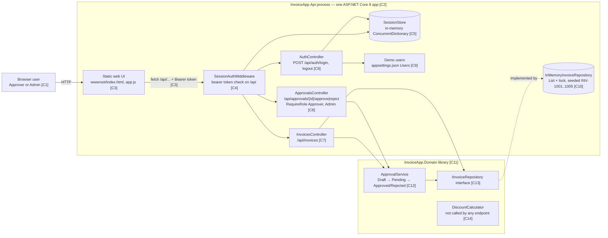
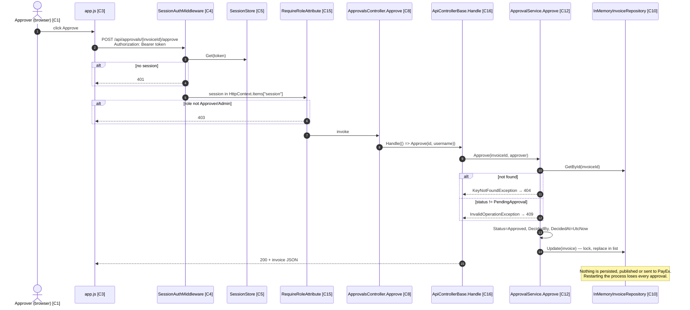
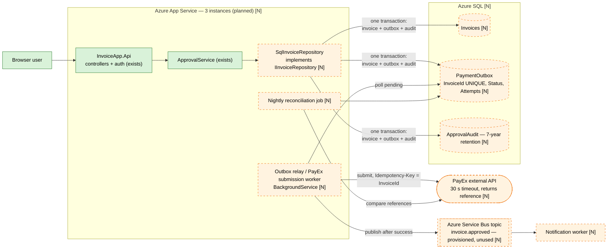

# Task 1: As-built and target architecture

Sources are in this folder as `.mmd` files, with rendered `.svg` copies next to them. I checked all three render with
Mermaid 11.4.1. The Mermaid MCP server is set up in `.mcp.json`.

Numbers like [C3] point to the citation table further down.

## As-built container view



## As-built sequence: approve an invoice



## Target state

Green exists today. Orange dashed does not exist yet.



[N] = not in the code. The planned shape comes from the brief, `ops/README.md`, INC-2041 (three instances behind a load
balancer) and INC-2047 (publisher, notification worker, Service Bus). The outbox and reconciliation parts follow ADR-001.

## Citations

| # | Element | File / symbol |
|---|---|---|
| C1 | Roles Approver, Admin | `appsettings.json`, `Users[].Role` |
| C2 | Single ASP.NET Core 8 process | `Program.cs`, `InvoiceApp.Api.csproj` (net8.0, Sdk.Web) |
| C3 | Static UI calling /api with bearer token | `wwwroot/app.js` line 19, `UseDefaultFiles`/`UseStaticFiles` in `Program.cs` |
| C4 | Token check on /api except login | `Auth/SessionAuthMiddleware.cs`, `InvokeAsync` |
| C5 | Sessions in memory | `Auth/SessionStore.cs`, `ConcurrentDictionary<string, UserSession>` |
| C6 | Login / logout | `Controllers/AuthController.cs` |
| C7 | Invoice CRUD + submit | `Controllers/InvoicesController.cs` (`Delete` has `[RequireRole("Admin")]`) |
| C8 | Approve / reject, class-level role filter | `Controllers/ApprovalsController.cs`, `[RequireRole("Approver","Admin")]` |
| C9 | Demo users from config | `Program.cs` `Configure<DemoUsersOptions>`, `Auth/UserSession.cs` |
| C10 | In-memory store, singleton | `InMemoryInvoiceRepository.cs`, `AddSingleton<IInvoiceRepository, InMemoryInvoiceRepository>` |
| C11 | Domain has no package references | `InvoiceApp.Domain.csproj` |
| C12 | Lifecycle rules | `Domain/ApprovalService.cs`: `Submit`, `Approve`, `Reject`, `EnsurePending` |
| C13 | Repository interface | `Domain/IInvoiceRepository.cs` |
| C14 | Discount rules, unused | `Domain/DiscountCalculator.cs` (no caller in `backend/src`) |
| C15 | 403 for wrong role | `Auth/RequireRoleAttribute.cs`, `OnActionExecuting` |
| C16 | Exception to 404/409/400 | `Controllers/ApiControllerBase.cs`, `Handle` |

## Inferred (could not cite)

1. Hosting on App Service with Azure SQL and Service Bus. Only the brief says this. There's no IaC, Dockerfile or connection string in the repo.
2. Three instances (from INC-2041). With today's code each instance would have its own invoices and sessions, because both stores are in-memory singletons.
3. PayEx over HTTPS. Only in `ops/` and the brief. There's no HTTP client in the code.
4. `/health`. `ci-pipeline.yml` waits on it, but no such endpoint is mapped. The pipeline's `docker build` also has no Dockerfile to use.
5. Event publisher and notification worker. They appear only in the INC-2047 logs.
6. Sessions surviving a restart. They don't, since `SessionStore` is in memory.

## Corrections

The agent's first pass took these from the repo docs as facts. I checked each one against the code.

| Claim (where it came from) | Actually | Evidence |
|---|---|---|
| Approval writes to SQL and calls PayEx (ops/) | In-memory only | `Program.cs` registration; AGENTS.md says ops/ is planned |
| All controllers inherit `ApiControllerBase` (AGENTS.md) | `AuthController : ControllerBase` | `AuthController.cs` |
| Route is `/api/invoices/{id}/approve` | `/api/approvals/{invoiceId}/approve` | `ApprovalsController` route attributes |
| `/health` exists (ci-pipeline.yml) | No | No `MapHealthChecks` in `Program.cs` |
| `DiscountCalculator` used for pricing | Nothing calls it | grep |
| Bulk approval exists (UC-1) | Only a brief in `docs/use-cases` | No bulk route |

## Architecture test

`backend/tests/InvoiceApp.Tests/ArchitectureTests.cs`

Rule: `InvoiceApp.Domain` must not reference ASP.NET Core, the Api project, SqlClient, EF Core, Dapper or Service Bus. I chose
this one because once persistence and PayEx go in, the easiest mistake is to put `SqlClient` or `ServiceBusClient` straight
into `ApprovalService`.

```bash
dotnet test backend/InvoiceApp.sln --filter "FullyQualifiedName~ArchitectureTests"
```

Expected: `Passed! - Failed: 0, Passed: 1`

To check that the test actually catches a violation, I added `<FrameworkReference Include="Microsoft.AspNetCore.App" />` to the Domain csproj
and a class using `Microsoft.AspNetCore.Http.IResult`. The test failed with
`InvoiceApp.Domain must not reference: Microsoft.AspNetCore.Http.Abstractions`. Then I reverted it.
